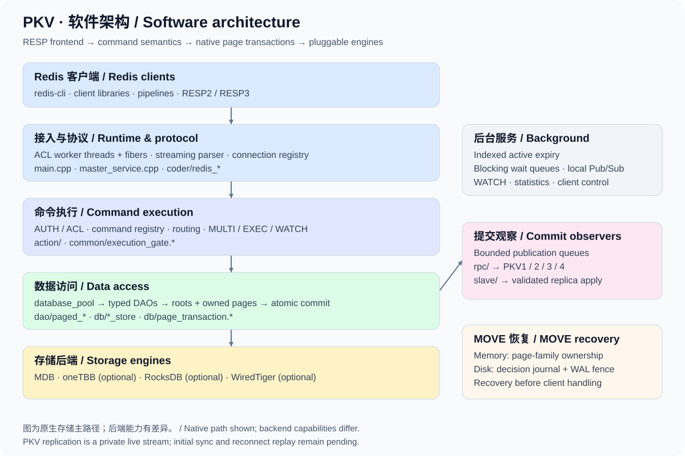
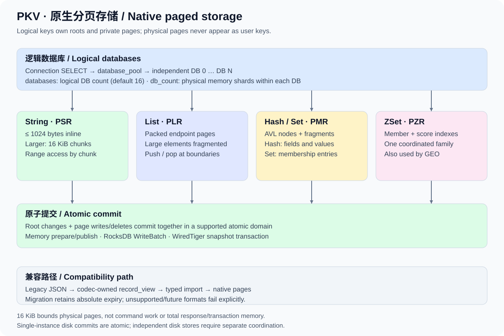

# PKV

**A Redis-protocol KV service built with worker threads, fibers, native paged storage and pluggable engines.**

[简体中文](README.md) · [Architecture](doc/ARCHITECTURE.en.md) · [Documentation](doc/README.md) · [Compatibility](doc/COMPATIBILITY.md) · [Roadmap](doc/ROADMAP_STATUS.md)

PKV is written in C++. It uses ACL threads and fibers for concurrent connections, a streaming request parser, and RESP2 / RESP3 replies. Its storage core represents String, List, Hash, Set and ZSet values as bounded native pages. Commands access roots and private pages through shared data-access interfaces backed by memory, RocksDB or WiredTiger.

Redis server compatibility is still under development. A registered command, passing targeted regression, or working live stream does not establish complete Redis replacement capability. Read the [current boundaries](#current-boundaries) before deployment.

## Architecture at a glance



Ordinary commands share execution admission and coordinate data access through key locks. Operations requiring isolation, including EXEC, take exclusive admission. Command semantics, native storage and engine implementations are separate layers. See the [architecture guide](doc/ARCHITECTURE.en.md) ([中文](doc/ARCHITECTURE.md)) for request paths, source entry points and commit boundaries.

## Current capabilities

| Area | Implemented behavior | Details |
| --- | --- | --- |
| Concurrency and protocol | Worker threads, ACL fiber I/O, streaming parsing, pipelines and HELLO negotiation of RESP2/RESP3 | [RESP3](doc/RESP3.md), [dispatch](doc/COMMAND_DISPATCH.md) |
| Native storage | Five basic types; inline/chunked Strings; bounded collection nodes and fragments | [Layout](#storage-layout), [formats and legacy data](doc/STORAGE_FORMAT.md) |
| Transactions and batches | MULTI/EXEC, WATCH; one workspace commit for eligible single-DB native EXEC; native atomic batch operations | [Transactions](doc/TRANSACTIONS.md), [source commits](doc/SOURCE_EXEC.md), [batch guarantees](doc/ATOMIC_BATCH.md) |
| Multiple databases | Connection-local SELECT, lazy logical databases, cross-DB COPY and native MOVE | [Logical DBs](doc/LOGICAL_DATABASES.md), [MOVE](doc/MOVE.md) |
| Expiry and keyspace | Millisecond deadlines, conditional expiry, indexed active expiry, SCAN, DBSIZE and RANDOMKEY | [Active expiry](doc/ACTIVE_EXPIRY.md), [SCAN](doc/SCAN.md) |
| Additional operations | Bitmaps / BITFIELD, HyperLogLog, GEO, blocking Lists/ZSets and local Pub/Sub | [Feature navigation](doc/README.md) |
| Security and diagnostics | AUTH, named ACL users with file persistence, ACL LOG, CLIENT, INFO and partial CONFIG | [Permissions](doc/ACL_PERMISSIONS.md), [INFO](doc/INFO.md), [configuration](doc/CONFIGURATION.md) |
| Live replication | Private PKV2–PKV5 streams; page transactions, whole EXEC groups, ordered edits and memory MOVE replay | [Replication boundaries](doc/ORDERED_REPLICATION.md) |

## Quick start

### 1. Install dependencies and build

Requirements: CMake 3.10+, a C/C++ compiler (C++17 by default, optional C++11), [ACL](https://github.com/acl-dev/acl) libraries `acl_all` / `fiber_cpp` / `fiber`, xxHash 0.8.0+, zlib and system threads. CMake must find the development headers and libraries. The examples use `redis-cli`; server integration tests use Python 3.

ACL can be installed with `make` followed by `make packinstall` in its source checkout; installing to system directories may require administrator access. Install the other development packages or follow their upstream build instructions for a custom prefix, supplied through `CMAKE_PREFIX_PATH`.

xxHash can also be compiled directly from a local source checkout without global installation:

```sh
cmake -S . -B build -DCMAKE_BUILD_TYPE=Release \
  -DPKV_XXHASH_SOURCE_DIR=/path/to/xxHash
cmake --build build -j 4
```

With dependencies installed, run `make`. Machine-specific paths can be stored in the Git-ignored `Makefile.local`:

```make
CMAKE_ARGS += -DPKV_XXHASH_SOURCE_DIR="/path/to/xxHash"
```

Storage and replication use native binary records. Use a new database or one containing native records. Legacy JSON records and compatibility conversion are no longer supported.

The executable is `build/pkv`; build artifacts stay outside the source directories. xxHash source mode uses a private namespace and leaves its checkout untouched. See the project's LGPL-2.1 [license](LICENSE) and the separately licensed [fpconv component](third_party/fpconv/ORIGIN.md).

If you have a `.profdata` file that matches the current sources and Clang toolchain, build the PGO variant in a separate directory.

```sh
make BUILD_DIR=build-pgo PKV_PGO_PROFILE=/path/to/pkv.profdata
```

### 2. Start the memory server

From the repository root:

```sh
./build/pkv alone mdb.cf
```

The sample client port is `19001`. This backend stores data in process memory and does not preserve it across restarts. Connect from another terminal:

```console
$ redis-cli -p 19001
127.0.0.1:19001> PING
PONG
127.0.0.1:19001> SET greeting "Hello, PKV" EX 60
OK
127.0.0.1:19001> GET greeting
"Hello, PKV"
127.0.0.1:19001> HSET user:1 name Alice language en
(integer) 2
127.0.0.1:19001> LPUSH jobs task:1 task:2
(integer) 2
127.0.0.1:19001> ZADD ranking 100 Alice 90 Bob
(integer) 2
```

Select a logical database and execute a transaction on the same connection:

```text
SELECT 1
MULTI
SET visits 0
INCR visits
GET visits
EXEC
```

EXEC returns three results: `OK`, `1` and `"1"`. Exact display formatting depends on the client version.

### 3. Choose a storage engine

Optional engines are disabled by default. Install their development dependencies and enable them explicitly:

```sh
make HAS_ROCKSDB=YES                 # RocksDB
make HAS_WT=YES                      # WiredTiger
make HAS_TBB=YES                     # oneTBB
# Flags can be combined; also available: HAS_JEMALLOC=YES, BUILD_WITH_C11=YES
```

| Backend | Startup configuration | Native five-type page transactions | Persistence and boundaries |
| --- | --- | --- | --- |
| `mdb` | `mdb.cf` | Supported | Default build; process memory |
| `mdb_tbb` | `mdb_tbb.cf` | Supported | Optional oneTBB; command key locks remain, so execution is not entirely lock-free |
| `rdb` | `rdb_native.cf` | Supported in one physical instance | Atomic WriteBatch; ordinary writes do not enable fsync by default |
| `wdb` | `wdb_native.cf` | Supported in one physical instance | Snapshot transactions with synchronous logging |
| `mdb_htable` / `mdb_avl` | Corresponding `.cf` files | No native collection page transactions | Legacy engine paths; Hash/List/Set/ZSet requests fail explicitly |

For example: `./build/pkv alone rdb_native.cf`. Native disk examples use separate fresh directories. Existing `rdb.cf` / `wdb.cf` configurations have multiple physical paths; they are not automatically merged or migrated. Atomic mutations across independent physical stores remain restricted. See [RocksDB](doc/ROCKSDB_STORAGE.md), [WiredTiger](doc/WIREDTIGER_STORAGE.md) and [oneTBB](doc/TBB_STORAGE.md).

## Storage layout



Native pages belong to a logical key. They reserve no user-key prefix and do not appear in SCAN. Strings inline up to 1024 bytes and use 16 KiB chunks for larger payloads. Lists use linked endpoint pages; Hashes/Sets use bounded AVL nodes and fragments; ZSets coordinate member and score indexes in one page family. Bounded pages do not imply constant command work, response size or transaction memory.

A codec compatibility layer reads legacy JSON. Applicable typed accesses and mutations migrate records atomically while retaining absolute expiry; MGET stays read-only. Follow the [format and upgrade notes](doc/STORAGE_FORMAT.md); no automatic downgrade tool is provided.

## Configuration essentials

Edit the `service pkv { ... }` block in the selected `.cf` file. These are selected fields, not a complete configuration:

| Setting | Meaning |
| --- | --- |
| `master_service` | ACL client listener, for example `127.0.0.1\|19001` |
| `service` | PKV address identity, default `127.0.0.1:19001`; keep it consistent with the client listener when changing ports; RPC uses this port plus 10000 |
| `fiber_threads` | ACL worker threads; use the value in the selected configuration |
| `dbtype` / `dbpath` | Engine and storage paths; multiple paths are not one atomic commit domain |
| `databases` | Logical database count, default 16; selected per connection |
| `db_count` | Physical memory shards per logical DB, default 256; independent of `databases` |
| `active_expire` | Active expiration, enabled by default; batch size and interval are configurable |
| `requirepass` / `aclfile` | Frontend default-user password or ACL user file |
| `replica_rpc_source` | Optional upstream RPC address, such as `127.0.0.1:29001`; not the Redis client port |
| `replica_read_only` | Rejects client writes by default on a configured live receiver |
| `move_journal_path` | Default `auto` binds a native disk pool to a MOVE decision journal; memory engines create no journal |

Frontend ACLs and the RPC startup password policy are separate; see [authentication](doc/AUTH.md). A bound disk MOVE domain must retain its root paths, DB count, markers and journal identity; disabling its journal is restricted. See [startup recovery](doc/MOVE_STARTUP.md).

## Current boundaries

- **Redis compatibility is ongoing.** Consult the [compatibility guide](doc/COMPATIBILITY.md) and `COMMAND` / `COMMAND INFO`. Full option coverage, Redis complexity bounds and performance parity are not claimed. Scripting, Streams and Redis RDB/AOF remain unfinished.
- **EXEC isolation differs from crash atomicity.** Eligible single-logical-DB, single-domain native transactions commit once. Cross-DB, multi-store and some legacy paths can retain a successful prefix after a crash. Runtime command errors do not roll back earlier successful commands.
- **Replication is a private live stream.** Initial synchronization, reconnect catch-up, Redis PSYNC and automatic failover remain unfinished. Subscribing cannot initialize an existing dataset; disk receivers lack durable mixed-group recovery involving MOVE.
- **Cluster behavior is incomplete.** Slot routing and checks exist; migration, ASK and automatic failover remain unfinished. Cluster mode permits DB 0 only. Local Pub/Sub does not broadcast across nodes.
- **Durability depends on engine policy.** A single disk MOVE has a decision journal and startup replay. That does not establish cross-DB recovery for an entire EXEC. Process-interruption tests do not establish power-loss safety.

## Tests and performance evidence

```sh
ctest --test-dir build --output-on-failure
```

Full server tests need Python 3 and permission to open temporary loopback TCP listeners. Optional backend tests depend on build flags. See the [test guide](tests/README.md) for standalone protocol tests, ASan/UBSan and reference-server comparisons. Historical test counts are not presented here as a fresh full-suite result.

The repository includes [String storage microbenchmarks](doc/STRING_STORAGE_BENCHMARK.md), [EXEC workspace costs](doc/SOURCE_EXEC_BENCHMARK.md), [dispatch measurements](doc/COMMAND_DISPATCH.md) and [expiry-index measurements](doc/EXPIRY_PERFORMANCE.md). Each result has workload, platform and revision limits; they do not establish an overall performance advantage over official Redis.

## Further reading and contributions

See [performance status](doc/PERFORMANCE_STATUS.md) for comparisons, negative samples and memory scope.
The latest [default 21-command P1/P64 comparison](doc/benchmarks/performance-default-node-encode-reuse-2026-11-08.md)
records the retained staging encoder change; the status page documents negative samples, six-round follow-ups and memory scope.

Start with the [architecture guide](doc/ARCHITECTURE.en.md) and [documentation index](doc/README.md), then run CTests relevant to your change. Describe the backend, build mode, behavior changes and validation scope. Storage-format, replication and recovery changes should also update their boundaries and migration notes.

The [oneTBB shard memory and P1/P64/P1024 study](doc/benchmarks/performance-tbb-shard-memory-2026-11-08.md) records both memory savings and throughput regressions; shard defaults remain unchanged. The subsequent [scan-directory experiment](doc/benchmarks/performance-tbb-scan-index-2026-11-08.md) was reverted after throughput regressions.

The [tiny-member List fill study](doc/benchmarks/performance-list-tiny-fill-2026-11-08.md) preserves all 720 timing samples and memory results; both candidates were reverted.

The retained [List callback borrowing fix](doc/benchmarks/performance-list-callback-borrow-2026-11-08.md) improves the four default P64 List tests by about 12–16%; P1 negative samples and memory limitations remain documented.

The [List client control study](doc/benchmarks/performance-list-client-control-2026-11-08.md) records identical-binary variability, old/current comparisons and current RPUSH profiles. The latest full default 21-command table remains linked above.
