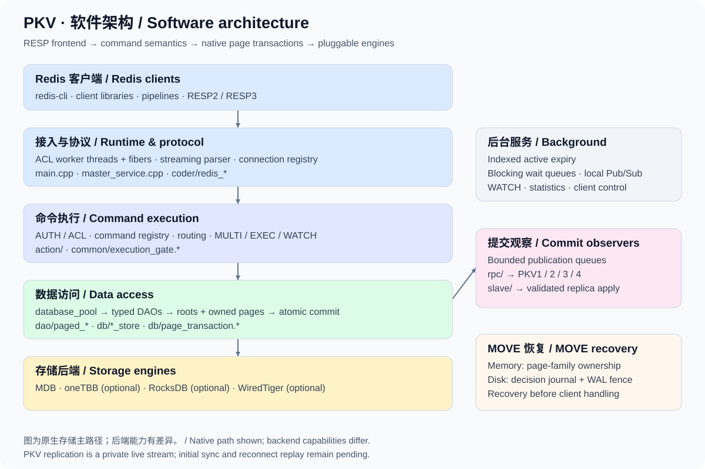
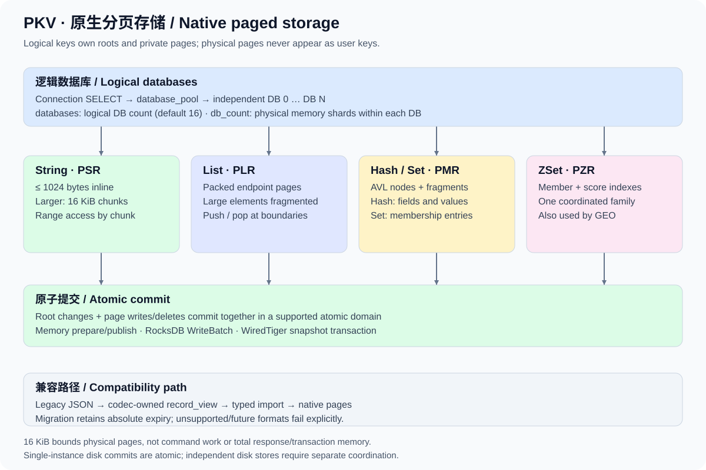

# PKV

**基于多线程与协程的 Redis 协议 KV 服务，支持原生分页存储和可插拔存储引擎。**

[English](README.en.md) · [软件架构](doc/ARCHITECTURE.md) · [文档导航](doc/README.md) · [兼容性](doc/COMPATIBILITY.md) · [阶段进展](doc/ROADMAP_STATUS.md)

PKV 使用 C++ 实现，通过 ACL 的线程与协程处理并发连接，以流式解析器接收请求，并提供 RESP2 / RESP3 响应。当前核心是 String、List、Hash、Set、ZSet 的原生有界页存储：命令通过统一的数据访问层操作根记录和私有页，底层可选择内存、RocksDB 或 WiredTiger。

项目仍在完善 Redis 服务端兼容性。命令注册、局部回归通过或实时复制可用，均不代表完整 Redis 替代能力；部署前请阅读[能力边界](#能力边界)。

## 架构一览



普通命令共享执行准入，并通过键锁协调数据访问；EXEC 等需要隔离的操作使用独占准入。命令语义、分页存储和具体引擎分层实现。详细的请求路径、源码入口和提交边界见[中文架构文档](doc/ARCHITECTURE.md)（[English](doc/ARCHITECTURE.en.md)）。

## 当前特点

| 方向 | 已实现的能力 | 进一步阅读 |
| --- | --- | --- |
| 并发与协议 | 多线程、ACL 协程 I/O、流式解析、pipeline、HELLO 协商 RESP2/RESP3 | [RESP3](doc/RESP3.md)、[命令分发](doc/COMMAND_DISPATCH.md) |
| 原生分页 | 五种基础类型；String 小值内联、大值分块；集合使用有界节点和片段 | [存储布局](#存储布局)、[格式与旧数据](doc/STORAGE_FORMAT.md) |
| 事务与批量 | MULTI/EXEC、WATCH；符合条件的单库原生 EXEC 通过工作区一次提交；原生批量读写 | [事务](doc/TRANSACTIONS.md)、[源端提交](doc/SOURCE_EXEC.md)、[批量保证](doc/ATOMIC_BATCH.md) |
| 多数据库 | 连接级 SELECT、按需创建逻辑库、跨库 COPY 和原生 MOVE | [逻辑库](doc/LOGICAL_DATABASES.md)、[MOVE](doc/MOVE.md) |
| 过期与键空间 | 毫秒级期限、条件过期、索引式主动过期、SCAN、DBSIZE、RANDOMKEY | [主动过期](doc/ACTIVE_EXPIRY.md)、[SCAN](doc/SCAN.md) |
| 扩展数据操作 | Bitmap / BITFIELD、HyperLogLog、GEO、阻塞 List/ZSet、本地 Pub/Sub | [功能导航](doc/README.md) |
| 认证与诊断 | AUTH、命名 ACL 用户与文件持久化、ACL LOG、CLIENT、INFO、部分 CONFIG | [权限](doc/ACL_PERMISSIONS.md)、[INFO](doc/INFO.md)、[配置](doc/CONFIGURATION.md) |
| 实时复制 | 私有 PKV1–PKV4 流；页事务、整组 EXEC、有序页编辑及内存 MOVE 重放 | [复制边界](doc/ORDERED_REPLICATION.md) |

## 快速开始

### 1. 准备依赖并构建

需要 CMake 3.10+、C/C++ 编译器（默认 C++17，可选 C++11）、[ACL](https://github.com/acl-dev/acl) 的 `acl_all` / `fiber_cpp` / `fiber`、[yyjson](https://github.com/ibireme/yyjson)、xxHash 0.8.0+、zlib 和线程库。开发头文件和库必须可被 CMake 找到。`redis-cli` 用于下方交互示例，Python 3 用于服务端集成测试。

ACL 可在其源码目录执行 `make` 和 `make packinstall` 安装；系统目录安装可能需要管理员权限。其他依赖可使用已安装的开发包，或按上游构建说明安装到自定义前缀，并通过 `CMAKE_PREFIX_PATH` 指定。

yyjson 和 xxHash 也可直接使用本地源码，不需要全局安装：

```sh
cmake -S . -B build -DCMAKE_BUILD_TYPE=Release \
  -DPKV_YYJSON_SOURCE_DIR=/path/to/yyjson \
  -DPKV_XXHASH_SOURCE_DIR=/path/to/xxHash
cmake --build build -j 4
```

若依赖已安装，直接运行 `make`。本地路径也可写入 Git 忽略的 `Makefile.local`：

```make
CMAKE_ARGS += -DPKV_YYJSON_SOURCE_DIR="/path/to/yyjson"
CMAKE_ARGS += -DPKV_XXHASH_SOURCE_DIR="/path/to/xxHash"
```

构建产物是 `build/pkv`，源码目录不生成可执行文件。xxHash 源码模式使用私有命名空间，不修改其源码目录。项目同时包含 LGPL-2.1 [许可证](LICENSE)和单独许可的 [fpconv](third_party/fpconv/ORIGIN.md)。

已有与当前源码和 Clang 工具链匹配的 `.profdata` 时，可用独立目录构建 PGO 版本。

```sh
make BUILD_DIR=build-pgo PKV_PGO_PROFILE=/path/to/pkv.profdata
```

### 2. 启动内存服务

在仓库根目录运行：

```sh
./build/pkv alone mdb.cf
```

示例配置的客户端端口是 `19001`，使用内存后端，不会在重启后保留数据。另开终端连接：

```console
$ redis-cli -p 19001
127.0.0.1:19001> PING
PONG
127.0.0.1:19001> SET greeting "Hello, PKV" EX 60
OK
127.0.0.1:19001> GET greeting
"Hello, PKV"
127.0.0.1:19001> HSET user:1 name Alice language zh-CN
(integer) 2
127.0.0.1:19001> LPUSH jobs task:1 task:2
(integer) 2
127.0.0.1:19001> ZADD ranking 100 Alice 90 Bob
(integer) 2
```

连接级数据库选择和事务示例（同一连接执行）：

```text
SELECT 1
MULTI
SET visits 0
INCR visits
GET visits
EXEC
```

EXEC 返回三个结果：`OK`、`1`、`"1"`。客户端版本不同，输出排版可能略有差异。

### 3. 选择存储引擎

可选引擎默认关闭，须先安装开发依赖，再显式启用：

```sh
make HAS_ROCKSDB=YES                 # RocksDB
make HAS_WT=YES                      # WiredTiger
make HAS_TBB=YES                     # oneTBB
# 可组合启用；其他选项：HAS_JEMALLOC=YES、BUILD_WITH_C11=YES
```

| 后端 | 启动配置 | 原生五类型页事务 | 持久化与边界 |
| --- | --- | --- | --- |
| `mdb` | `mdb.cf` | 支持 | 默认构建；进程内存 |
| `mdb_tbb` | `mdb_tbb.cf` | 支持 | 可选 oneTBB；保留命令键锁，并非全路径无锁 |
| `rdb` | `rdb_native.cf` | 单物理实例支持 | 原子 WriteBatch；普通写默认不启用 fsync |
| `wdb` | `wdb_native.cf` | 单物理实例支持 | 快照事务与同步日志 |
| `mdb_htable` / `mdb_avl` | 同名 `.cf` | 不支持原生集合页事务 | 旧引擎路径；Hash/List/Set/ZSet 请求显式拒绝 |

例如：`./build/pkv alone rdb_native.cf`。原生磁盘示例使用独立新目录；旧的 `rdb.cf` / `wdb.cf` 包含多个物理路径，不会自动合并或迁移。跨独立物理存储的原子变更仍受限制。详见 [RocksDB](doc/ROCKSDB_STORAGE.md)、[WiredTiger](doc/WIREDTIGER_STORAGE.md) 和 [oneTBB](doc/TBB_STORAGE.md)。

## 存储布局



原生页属于逻辑键，不占用用户键名，也不出现在 SCAN 结果中。String 的小值最多内联 1024 字节；较大值使用 16 KiB 分块。List 使用双端页链，Hash/Set 使用有界 AVL 节点与片段，ZSet 在同一页族中维护成员索引和分数索引。页大小有界不代表整个命令、结果集或事务的内存恒定。

旧 JSON 记录通过 codec 兼容层读取，在适用的类型访问或变更路径上原子迁移并保留绝对过期时间；MGET 保持只读。升级和降级须遵守[格式文档](doc/STORAGE_FORMAT.md)，没有自动降级工具。

## 配置要点

修改所选 `.cf` 的 `service pkv { ... }` 配置块；以下为关键字段说明，并非完整配置：

| 参数 | 含义 |
| --- | --- |
| `master_service` | ACL 客户端监听地址，示例 `127.0.0.1\|19001` |
| `service` | PKV 服务地址标识，默认 `127.0.0.1:19001`；修改端口时与监听配置保持一致，RPC 端口由此加 10000 |
| `fiber_threads` | ACL 工作线程数；以所选配置文件为准 |
| `dbtype` / `dbpath` | 后端及存储路径；多路径不等同于一个原子提交域 |
| `databases` | 逻辑库数量，默认 16；SELECT 按连接选择 |
| `db_count` | 每个内存逻辑库的物理分片数，默认 256，与逻辑库数量独立 |
| `active_expire` | 主动过期，默认启用；批次与间隔可配置 |
| `requirepass` / `aclfile` | 前端默认用户密码或 ACL 用户文件 |
| `replica_rpc_source` | 可选上游 RPC 地址，例如 `127.0.0.1:29001`；不是 Redis 客户端端口 |
| `replica_read_only` | 配置实时接收端后默认拒绝客户端写入 |
| `move_journal_path` | 默认 `auto`：原生磁盘池绑定 MOVE 决策日志；内存后端不创建日志 |

前端 ACL 与 RPC 启动密码策略分别处理，详见[认证](doc/AUTH.md)。已绑定的磁盘 MOVE 域必须保留根路径、逻辑库数量、标记与日志身份，不能随意关闭日志，见[启动恢复](doc/MOVE_STARTUP.md)。

## 能力边界

- **Redis 兼容仍在进行。** 当前命令族覆盖见[兼容性文档](doc/COMPATIBILITY.md)和 `COMMAND` / `COMMAND INFO`；不承诺完整选项、复杂度或性能等同于 Redis。脚本、Streams、Redis RDB/AOF 等仍未完成。
- **EXEC 隔离与崩溃原子性有区别。** 满足条件的单逻辑库、单提交域原生事务一次提交；跨库、多物理存储及部分旧路径仍可能在崩溃后保留成功前缀。运行时命令错误不会回滚此前成功命令。
- **复制是私有实时流。** 尚无全量同步、断线补齐、Redis PSYNC 或自动故障切换。已有数据不能仅靠订阅流初始化；磁盘接收端尚不支持含 MOVE 的混合组持久恢复。
- **集群功能尚不完整。** 已有槽位路由与检查，但迁移、ASK 和自动故障切换未完成；集群模式限 DB 0。本地 Pub/Sub 不提供跨节点广播。
- **持久化取决于引擎策略。** 单次磁盘 MOVE 有独立决策日志与启动重放；这不是整个 EXEC 的跨库恢复保证。进程中断测试不等同于断电安全验证。

## 测试与性能资料

```sh
ctest --test-dir build --output-on-failure
```

完整服务测试需要 Python 3 及创建临时回环 TCP 监听的权限；可选后端测试取决于构建开关。独立协议测试、ASan/UBSan 和参考服务对比方法见[测试指南](tests/README.md)。本次文档不把历史测试数量当作当前全量验证结果。

仓库保留了 [String 存储微基准](doc/STRING_STORAGE_BENCHMARK.md)、[EXEC 工作区开销](doc/SOURCE_EXEC_BENCHMARK.md)、[命令分发测量](doc/COMMAND_DISPATCH.md)和[过期索引测量](doc/EXPIRY_PERFORMANCE.md)。这些结果各有负载、平台与版本范围，不构成对官方 Redis 的整体性能优势结论。

## 深入阅读与贡献

[性能进度](doc/PERFORMANCE_STATUS.md)记录当前数据及历史实验。[变更型命令基线](doc/benchmarks/performance-mutation-matrix-2026-11-09.md)给出 24 个写入场景的 P1/P64、延迟与内存。累计有 126/188 条注册顶层命令具备命名性能场景。[位图单页复制专项](doc/benchmarks/performance-bitmap-page-write-2026-11-09.md)记录等值 SETBIT、BITOP 与混合写入内存。[密集 PFMERGE 写回](doc/benchmarks/performance-hll-merge-write-2026-11-09.md)的单工作线程 P64 等值写入在独立长测中达到隔离 Redis 的约 91%。

[Set 与 ZSet 运算矩阵](doc/benchmarks/performance-set-algebra-matrix-2026-11-09.md)覆盖交并差集、基数查询、结果存储和范围删除，包含三阶段内存和本机压测客户端的 Pipeline 计数诊断。

[紧凑 ZSet 单成员弹出](doc/benchmarks/performance-compact-zset-single-pop-2026-11-09.md)给出 MDB、oneTBB 与 Redis 的 P1/P64、四工作线程和写后内存对照。单工作线程 P64 顺序 32 成员 `ZPOPMAX` 的 MDB 吞吐为 Redis 的约 53%。

[分页 ZSet 批量弹出](doc/benchmarks/performance-zset-pop-remainder-2026-11-09.md)覆盖 `ZPOPMAX`、`ZMPOP` 和超长成员回退。192 成员形态每键弹出 96 个后，MDB 的堆增量约为父版的 27%。

同一父版上的[扩展 100 场景对照](doc/benchmarks/performance-expanded-command-matrix-2026-11-09.md)和[默认 21 场景对照](doc/benchmarks/performance-default-native-list-prepend-2026-11-09.md)合计覆盖 188 条注册顶层命令中的 85 条，另有上方的 PFMERGE 专项。[22 种形态的逐类型内存与 List 专项](doc/benchmarks/performance-native-list-prepend-2026-11-09.md)保留 LPUSH/RPUSH、GET 对照和内存数据。其余命令、各命令选项及大集合内存仍需验证和优化。
历史 C41 的[MDB分页目录实验](doc/benchmarks/performance-mdb-small-page-directory-2026-11-09.md)保留内存收益与GET回退记录；C42 [小型记录桶原型](doc/benchmarks/performance-mdb-record-bucket-rejected-2026-11-09.md)因大键空间GET回退已撤回。C39 的[Hash查找](doc/benchmarks/performance-hash-single-lookup-2026-11-09.md)与 C40 的[List已知TTL提交](doc/benchmarks/performance-list-known-deadline-2026-11-09.md)亦保留各自测量范围。上述 C32 表是历史已验收版本，C46仍是局部实验性改进。
历史 C43 的[List整数写入实验及构建审计](doc/benchmarks/performance-list-endian-writes-rejected-2026-11-09.md)因端到端收益不足已撤回：指令数减少并未解决List管线差距，最终源码、目标文件和程序均恢复至C41基线。
新增 [oneTBB 分片内存及 P1/P64/P1024 专项](doc/benchmarks/performance-tbb-shard-memory-2026-11-08.md)：内存收益与吞吐回退并存，默认分片数暂未调整。 后续[扫描索引压缩实验](doc/benchmarks/performance-tbb-scan-index-2026-11-08.md)因吞吐负样本已撤回。

先阅读[软件架构](doc/ARCHITECTURE.md)和[文档导航](doc/README.md)，再根据修改范围运行相关 CTest。提交变更时说明后端、构建模式、行为变化及验证范围；涉及存储格式、复制或恢复时，同时更新边界与迁移说明。

最近的[小元素 List 填充实验](doc/benchmarks/performance-list-tiny-fill-2026-11-08.md)保留全部 720 项时序和内存负样本，两个候选均已撤回。

已保留[紧凑 List 分流的回调借用修复](doc/benchmarks/performance-list-callback-borrow-2026-11-08.md)，默认 P64 四项 List 吞吐提高约 12%–16%；P1 负样本和内存范围见报告，整体目标仍未完成。

[List读取客户端控制对照](doc/benchmarks/performance-list-client-control-2026-11-08.md)记录同版本波动、旧/新复核及当前RPUSH采样；默认21项全表仍见上文。

[2026-11-08 请求对象回收候选撤回：72项P64与完整证据](doc/benchmarks/performance-object-bulk-return-2026-11-08.md)

[2026-11-08 List缓存候选撤回：108项P1/P64与内存观测](doc/benchmarks/performance-list-cache-append-2026-11-08.md)

[2026-11-08 List检查器候选撤回：216项P1/P64及分配证据](doc/benchmarks/performance-list-inspector-inline-2026-11-08.md)

[2026-11-08 LRANGE结果复用候选撤回：162项对照与分配证据](doc/benchmarks/performance-list-result-reuse-2026-11-08.md)

[2026-11-08 LRANGE整帧候选撤回：1428项最终对照、混合短值与恢复记录](doc/benchmarks/performance-list-range-stream-2026-11-08.md)

[2026-11-08 按页RESP分块原型：216项编码微测，尚未接入服务端](doc/benchmarks/performance-list-segment-codec-prototype-2026-11-08.md)

[2026-11-08 分段LRANGE集成候选撤回：240项DAO、108项P1/P64与恢复证据](doc/benchmarks/performance-list-segment-integration-2026-11-08.md)

[2026-11-08 Hash表示边界：96项内存、288项P1/P64与实际页面结构](doc/benchmarks/performance-hash-representation-boundary-2026-11-08.md)

[2026-11-08 保留紧凑Hash等长覆盖：144项DAO、804项网络与全部复核](doc/benchmarks/performance-hash-owned-overwrite-2026-11-08.md)

[2026-11-08 历史C31默认21项P1/P64及p99：378项对照，保留全部负样本](doc/benchmarks/performance-default-hash-owned-overwrite-2026-11-08.md)

[2026-11-08 保留Hash同步回调引用：360项DAO、1104项网络，含默认、多线程与控制项代价](doc/benchmarks/performance-hash-callback-borrow-only-2026-11-08.md)

[2026-11-08 单根512字段Hash实验否决：720项DAO，空间收益与点操作回退](doc/benchmarks/performance-hash-wide-root-prototype-2026-11-08.md)

[2026-11-08 自适应分组Hash实验及根/页编码器基础：命令路径尚未启用](doc/benchmarks/performance-hash-grouped-pages-prototype-2026-11-08.md)

[2026-11-08 分组Hash事务接口：增长、删除、回退、SCAN及1536项DAO验证，命令分流待接通](doc/benchmarks/implementation-packed-hash-store-2026-11-08.md)
