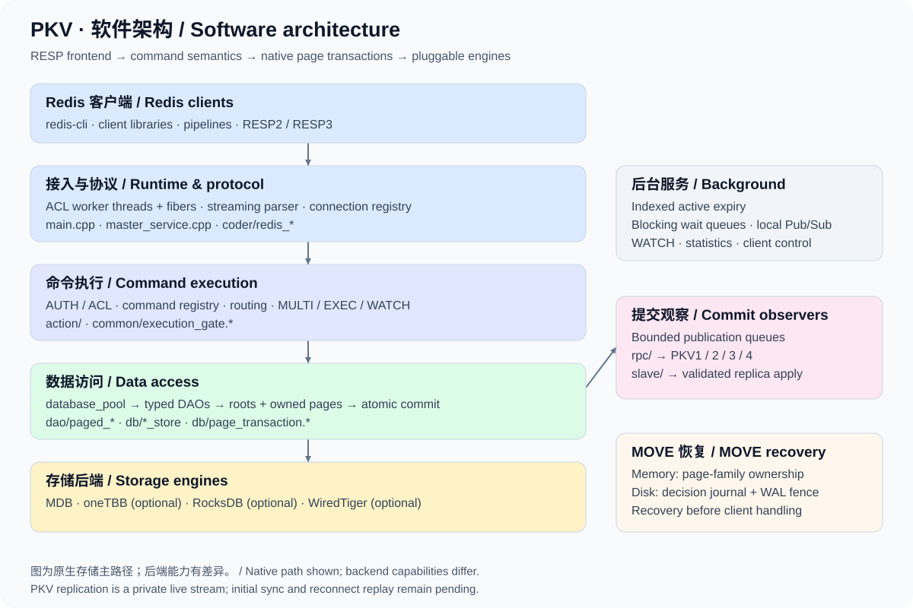
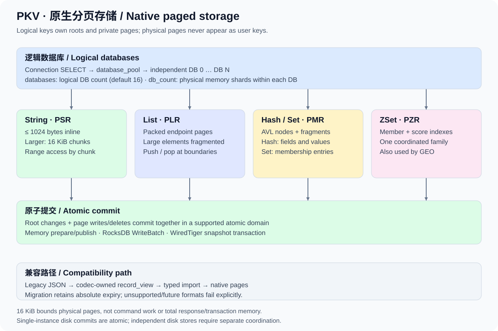

# PKV software architecture

[简体中文](ARCHITECTURE.md) · [Project README](../README.en.md) · [Documentation](README.md)

This guide describes module responsibilities, data flow and consistency boundaries in the current source. PKV is a C++ Redis-protocol KV service. ACL worker threads and fibers handle connections; shared DB interfaces connect native paged data structures to multiple storage engines. Complete Redis compatibility, full synchronization and distributed recovery remain ongoing. See the [roadmap](ROADMAP_STATUS.md).

## 1. Layers and source map

| Layer / module | Responsibility | Main source entry points |
| --- | --- | --- |
| Process and runtime | ACL initialization, signal shutdown, configuration, database pool, startup recovery and per-thread resources | [`main.cpp`](../main.cpp), [`master_service.cpp`](../master_service.cpp), [`common/shutdown_signals.cpp`](../common/shutdown_signals.cpp) |
| Protocol | Incremental parsing, request-object caching, reply construction and RESP encoding | [`coder/redis_coder.cpp`](../coder/redis_coder.cpp), [`coder/redis_object.cpp`](../coder/redis_object.cpp), [`coder/redis_response.cpp`](../coder/redis_response.cpp) |
| Connections and commands | Session DB/protocol/user, command registry, ACLs, routing, transactions, diagnostics, Pub/Sub and blocking commands | [`action/redis_handler.cpp`](../action/redis_handler.cpp), [`action/redis_service.cpp`](../action/redis_service.cpp), `action/redis_*.cpp` |
| Data access | Redis type operations, errors and expiry semantics, legacy import | `dao/paged_*.cpp`, [`dao/native_import.cpp`](../dao/native_import.cpp), `dao/json/` |
| Storage coordination | Database pool, key locks, page transactions/workspaces, typed stores, WATCH, expiry indexes and MOVE | [`db/db.h`](../db/db.h), [`db/page_transaction.h`](../db/page_transaction.h), `db/*_store.*` |
| Engines | Physical root/page reads and writes, atomic commits, cursors, recovery and durability barriers | `db/mdb/`, `db/rocksdb/`, `db/wt/` |
| Encoding | Native root/page formats, codec-independent record views and legacy JSON | `coder/*_page.*`, [`coder/record_codec.h`](../coder/record_codec.h), [`coder/json_record_codec.cpp`](../coder/json_record_codec.cpp) |
| Replication and cluster | Bounded frames, groups, subscriptions, receiver replay, slot and topology checks | `rpc/`, `slave/`, `sync/`, `cluster/` |
| Validation and tooling | C++ storage/protocol fixtures, Python socket scenarios and microbenchmarks | `tests/`, `tools/`, [`tests/README.md`](../tests/README.md) |

The historical names `dao/json/` and `json_*` do not mean every value is still stored as one JSON record. Native layouts live in `db/*_store` and `coder/*_page`; DAOs supply command-level data-operation policies.

## 2. How a request executes

1. **Receive and parse.** ACL workers run fiber schedulers. `master_service::run` creates a parser and `redis_handler` for each connection. Incoming bytes are parsed incrementally across fragmented requests and pipelines; a socket read need not contain a complete command. Request-object caches are per thread.
2. **Session and admission.** Connections retain user identity, RESP version, selected DB, WATCH and MULTI state. The registry supplies handlers, arity, key specifications and admission categories. The frontend checks authentication, permissions, replica write policy and routing. Exact error precedence is defined by the handler.
3. **Typed access.** Under key locks, DAOs check type, expiry and legacy format, read roots or relevant pages, and propose changes. Multi-key operations use a common lock order to prevent opposing access directions from deadlocking.
4. **Commit and local effects.** Supported native engines atomically commit root/page changes. Successful paths update WATCH, expiry indexes, key counts and blocked-reader readiness. Failed commits publish no successful mutation.
5. **Observe and reply.** Commit observers capture replication events for asynchronous bounded queues. The frontend constructs replies in the connection's protocol. A connection can fail after storage commits, so a missing acknowledgement does not prove the write did not happen.

Ordinary KV commands share execution admission, allowing different keys to run concurrently; key locks still coordinate same-key and multi-key operations. EXEC, MOVE and selected administrative/keyspace operations use exclusive admission. Admission follows the current fiber, not just its OS thread. An independent CLIENT control path can close or unblock another connection while it holds KV admission. Blocking waits release ordinary shared admission to avoid stopping all other work. See [dispatch](COMMAND_DISPATCH.md), [transactions](TRANSACTIONS.md) and [blocking commands](BLOCKING.md).

## 3. Logical databases, roots and page families

### Logical databases versus physical shards

`database_pool` creates logical databases lazily. SELECT affects only the current connection. Each database owns its keyspace, locks and expiry state. `databases` defaults to 16 and controls logical DB selection; `db_count` defaults to 256 and controls physical memory shards within each logical DB. These settings are independent.

Disk DB 0 keeps the original path layout; DB N adds `logical-db-N` under each configured root. Independent disk paths do not form one atomic commit domain. Cluster mode permits DB 0 only. See [logical databases](LOGICAL_DATABASES.md) and [native path handling](NATIVE_PATHS.md).

### Type representations

A logical key maps to a bounded root. Private pages belong to its `(logical key, page id)` family, separate from user keys. Type, count and expiry metadata can be read from a root without always loading collection payloads.

| Type | Root signature | Organization | Access behavior |
| --- | --- | --- | --- |
| String | PSR v1/v2 | Up to 1024 inline bytes, with 16 KiB chunks for larger values | GETRANGE/APPEND/SETRANGE touch relevant chunks. Inline reads have a dedicated fast path. |
| List | PLR v2, with v1 root compatibility | Linked, packed endpoint pages; fragmented large elements | Endpoint push/pop edits boundary pages; ranges skip unrelated elements |
| Hash | PMR v2 / v3 | Small single trees; adaptive two-level bucket directories at 129 fields, AVL nodes and large payload fragments | Field lookup, counts and rank sampling; subtree counts in nodes |
| Set | PMR v2, Set kind | Map trees with empty membership values | Membership, set algebra and sampling |
| ZSet | PZR v1 | Coordinated member and score/member trees in one family | Member lookup and score ranges update together; GEO reuses ZSet |

Physical pages are at most 16 KiB. This bounds storage units, not the total work or memory of a command. Whole GETs, ranges, set algebra, reply construction and transactions can still scale with the requested data. See [String](STRING_PAGES.md), [List](LIST_STORAGE.md), [Hash](MAP_STORAGE.md), [Set](SET_STORAGE.md) and [ZSet](ZSET_STORAGE.md).

### Legacy compatibility

`record_codec` and owning `record_view` isolate DAOs from yyjson. Stored-format dispatch recognizes native signatures before passing legacy JSON to the codec. Applicable single-key typed accesses and mutations import records into bounded pages atomically while retaining absolute expiry; MGET does not write for migration. Format maintenance differs from user mutation for WATCH. Corrupt or unknown versions must not be mistaken for safely deletable expired data. See [formats and downgrade policy](STORAGE_FORMAT.md) and [legacy expiry migration](LEGACY_EXPIRY.md).

## 4. Atomic commits, EXEC and durability

`db::transact_pages` collects root edits, page writes and page deletions into a batch under logical-key locks. Typed stores must finish within the callback; errors or unfinished mutations prevent partial page commits.

| Engine | Commit mechanism | Boundary |
| --- | --- | --- |
| MDB / oneTBB | Prepare allocations while retaining rollback, then publish native changes | In-memory atomicity, without restart persistence; oneTBB retains command locks |
| RocksDB | One WriteBatch across roots/pages and related column families in one instance | Ordinary writes use the default non-fsync policy; independent instances gain no cross-instance atomicity |
| WiredTiger | One snapshot transaction with synchronous logging for roots, pages and scan entries | Mutations across independent paths are restricted |
| Legacy memory engines | Legacy record interfaces | No native collection page transactions; collection commands fail explicitly |

MULTI queues commands with owned argument snapshots. EXEC takes exclusive admission and freezes its expiry clock. WATCH checks mutation epochs protected by key locks. Eligible single-logical-DB, single-commit-domain native EXEC groups stage in a workspace. Later commands read earlier staged writes; successful mutations reach the engine in one final commit. A failed final commit discards tentative success replies and returns a storage error.

**This does not provide crash rollback for every EXEC.** Cross-DB, multi-store, MOVE and some legacy paths bypass the single-DB workspace. Runtime errors do not undo earlier successful commands; fallback execution can also leave a committed prefix after a crash. See [source EXEC](SOURCE_EXEC.md), [workspaces](PAGE_WORKSPACES.md) and [batch guarantees](ATOMIC_BATCH.md).

### MOVE has a separate cross-DB coordinator

Memory MOVE uses preparation/publication to transfer page-table ownership without copying existing native collection payload pages. Disk MOVE uses a coordinator retaining source/target locks, a source WAL fence, a single-decision journal and bounded page redo. Target publication precedes source removal. The default `move_journal_path=auto` binds native disk pools; startup replays recovery before client handling, active expiry and RPC workers. The identity binds backend, logical DB count, ordered canonical roots and journal location, so those settings cannot be changed arbitrarily.

The journal protects one MOVE, not an entire multi-command EXEC. SIGKILL recovery tests establish process-interruption behavior, not physical power-loss safety. See [MOVE](MOVE.md), [storage coordination](MOVE_STORAGE.md), [startup recovery](MOVE_STARTUP.md) and [durability barriers](DURABILITY_BARRIERS.md).

## 5. Commit observation and private replication

After storage commits, observers pass immutable changes to the publication queue and subscriber outputs. Receivers validate complete frames/groups before applying them under the DB/key locks and execution coordination used by commands. Replica applications avoid echoing their updates through source observers.

| Private version | Added capability | Boundary |
| --- | --- | --- |
| PKV1 | Network-order framing and logical DB identity | Legacy subscribers receive DB 0 only |
| PKV2 | Atomic BEGIN / root / page / COMMIT groups | Older versions cannot represent native pages and disconnect on unsupported events |
| PKV3 | Whole-EXEC envelopes; single-DB native groups apply once | Does not establish cross-DB disk recovery |
| PKV4 | Ordered page edits and MOVE ownership intents; memory receiver workspaces | Disk receivers reject unsupported mixed MOVE groups while retaining original data |

Queue budgets charge encoded bytes and record counts. Slow-subscriber or publisher-budget overflow disconnects affected streams even though source writes may already have committed. Reconnection renegotiates the stream but does not replay missing updates. Replica client reads hide expired values logically while retaining pages needed by delayed deltas. A configured receiver rejects client writes by default.

**This is a private PKV live protocol.** Initial synchronization, offset acknowledgements, reconnect catch-up, Redis PSYNC, automatic failover and durable disk mixed-group recovery remain unfinished. See [base replication](REPLICATION.md), [page replication](PAGE_REPLICATION.md), [EXEC replication](EXEC_REPLICATION.md), [ordered replication](ORDERED_REPLICATION.md) and [replica read retention](REPLICA_READ_RETENTION.md).

## 6. Background services and extension points

- **Active expiry:** primary services maintain a deadline index and process bounded batches, rechecking deadlines under key locks and reclaiming page families. Startup/repair indexing still has scan and memory costs. See [active expiry](ACTIVE_EXPIRY.md).
- **Blocking commands:** typed FIFO wait queues consume post-commit readiness notifications, with timeouts, disconnect cancellation and CLIENT UNBLOCK. See [Lists](BLOCKING.md) and [ZSets](BLOCKING_ZSET.md).
- **Pub/Sub:** local cross-thread routing, shared-message fanout and bounded slow-client output. It is not a cross-node message bus. See [Pub/Sub](PUBSUB.md).
- **Control plane:** lifecycle-aware client registries, AUTH/ACL, configuration validation and worker statistics provide diagnostics and control, with narrower scope than complete Redis operations. See [client registry](CLIENT_REGISTRY.md), [permissions](ACL_PERMISSIONS.md) and [INFO](INFO.md).

New commands should integrate with the registry, arity/key metadata and ACLs, reusing typed DAOs and page transactions where possible. New engines must implement or explicitly decline native transactions, cursors, observers, prepared commits and durability capabilities. New formats need version dispatch, corruption tests, legacy migration and downgrade policy. Every write path should consider WATCH, TTL, key counts, blocked-reader readiness and replication events.

Use the [test guide](../tests/README.md) for validation. Historical benchmarks and reports retain their own source, platform and selected-scenario scope; they do not establish results on untested platforms or overall Redis performance. See the [roadmap](ROADMAP_STATUS.md) for remaining work.
