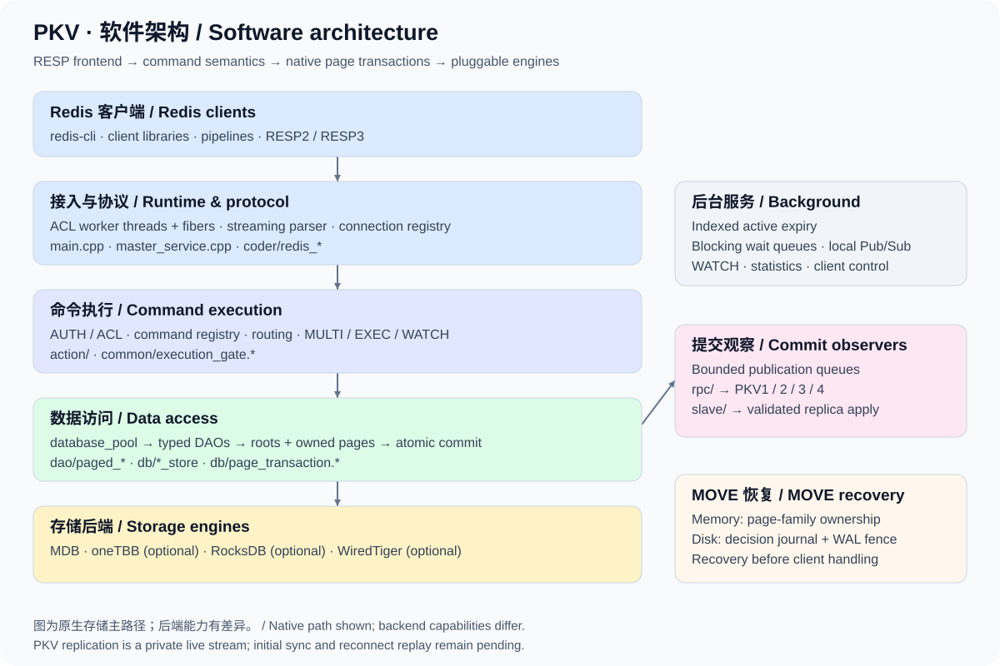
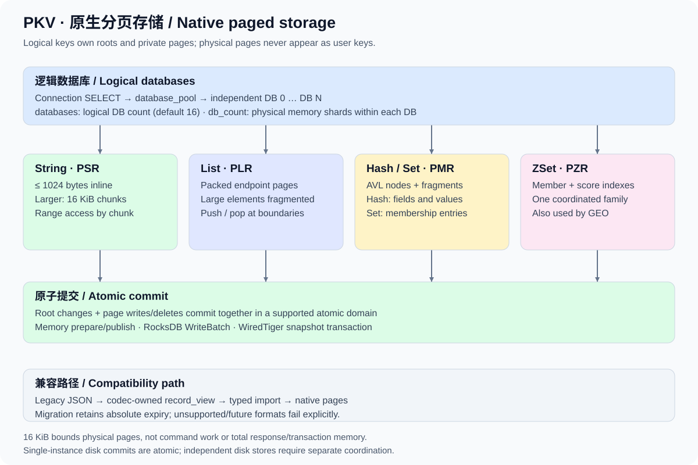

# PKV 软件架构

[English](ARCHITECTURE.en.md) · [项目首页](../README.md) · [文档导航](README.md)

本文按当前源码说明 PKV 的模块职责、数据流和一致性边界。PKV 是一个 C++ Redis 协议 KV 服务：以 ACL 多线程和协程承载连接，以统一 DB 接口连接原生分页数据结构及多个存储引擎。完整 Redis 兼容、全量复制与分布式恢复仍在建设中，阶段状态见[路线图](ROADMAP_STATUS.md)。

## 1. 系统分层与源码地图

| 层次 / 模块 | 职责 | 主要源码入口 |
| --- | --- | --- |
| 进程与运行时 | 初始化 ACL、信号退出、加载配置、创建数据库池、启动前恢复及线程级资源 | [`main.cpp`](../main.cpp)、[`master_service.cpp`](../master_service.cpp)、[`common/shutdown_signals.cpp`](../common/shutdown_signals.cpp) |
| 协议 | 增量解析、请求对象缓存、回复构造与 RESP 编码 | [`coder/redis_coder.cpp`](../coder/redis_coder.cpp)、[`coder/redis_object.cpp`](../coder/redis_object.cpp)、[`coder/redis_response.cpp`](../coder/redis_response.cpp) |
| 连接与命令 | 会话 DB/协议/用户、命令注册、ACL、路由、事务、诊断、Pub/Sub 与阻塞命令 | [`action/redis_handler.cpp`](../action/redis_handler.cpp)、[`action/redis_service.cpp`](../action/redis_service.cpp)、`action/redis_*.cpp` |
| 数据访问 | Redis 类型操作、错误与过期语义、旧记录导入 | `dao/paged_*.cpp`、[`dao/native_import.cpp`](../dao/native_import.cpp)、`dao/json/` |
| 存储协调 | 数据库池、键锁、页事务与工作区、类型存储、WATCH、过期索引、MOVE | [`db/db.h`](../db/db.h)、[`db/page_transaction.h`](../db/page_transaction.h)、`db/*_store.*` |
| 引擎 | 根记录和私有页的物理读写、原子提交、游标、恢复和同步屏障 | `db/mdb/`、`db/rocksdb/`、`db/wt/` |
| 编码 | 原生根/页格式、codec 无关的记录视图、旧 JSON 读写 | `coder/*_page.*`、[`coder/record_codec.h`](../coder/record_codec.h)、[`coder/json_record_codec.cpp`](../coder/json_record_codec.cpp) |
| 复制与集群 | 有界帧、分组、订阅、接收重放、槽位和拓扑检查 | `rpc/`、`slave/`、`sync/`、`cluster/` |
| 验证与工具 | C++ 存储/协议测试、Python socket 场景、微基准 | `tests/`、`tools/`、[`tests/README.md`](../tests/README.md) |

`dao/json/` 和 `json_*` 名称保留了历史接口，不表示当前所有值仍以整条 JSON 存储。原生存储布局由 `db/*_store` 与 `coder/*_page` 实现，DAO 负责命令层的数据操作策略。

## 2. 一次请求如何执行

1. **接收与解析。** ACL 工作线程运行协程调度器；`master_service::run` 为连接创建解析器和 `redis_handler`。读取到的数据增量交给解析器，支持拆包和连续 pipeline，不要求一次读取包含完整命令。每个线程有独立请求对象缓存。
2. **会话与准入。** 连接保存用户、RESP 版本、选中逻辑库、WATCH 和 MULTI 状态。命令注册表提供处理函数、参数数量、键规格及准入分类；处理器执行认证、权限、副本只读、路由等检查。具体错误优先级以处理器为准。
3. **类型操作。** 类型 DAO 在键锁保护下检查类型、过期和旧格式，读取根记录或触达相关页，并生成根/页修改。多键操作按统一顺序加锁，避免相反访问方向造成死锁。
4. **提交与本地效果。** 支持的原生后端将根和页的变更原子提交；成功路径维护 WATCH、过期索引、键计数和阻塞读取就绪状态。失败提交不发布成功变更。
5. **观察与回复。** 提交观察器捕获复制事件，经有界队列异步发送；前端按连接协议生成回复。存储成功后连接断开仍可能导致客户端收不到确认，不能由此判断写入未发生。

普通 KV 命令使用共享执行准入，允许不同键并发；相同键以及多键读写仍由键锁协调。EXEC、MOVE 和部分管理/键空间操作使用独占准入。准入状态跟随当前协程，而不是只跟随 OS 线程。独立 CLIENT 控制路径可在其他连接占有 KV 准入时关闭或解阻塞它。阻塞操作等待时释放普通共享准入，避免把等待变成全局停顿。见[执行分发](COMMAND_DISPATCH.md)、[事务](TRANSACTIONS.md)与[阻塞命令](BLOCKING.md)。

## 3. 逻辑库、根记录和页族

### 逻辑库与物理分片

`database_pool` 按需创建逻辑数据库。`SELECT` 只改变当前连接的 DB；每个库拥有独立键空间、锁与过期状态。`databases` 默认 16，决定可选逻辑库数量；`db_count` 默认 256，是每个内存库的物理分片数。二者不能互相替代。

磁盘 DB 0 保持原路径；DB N 在各配置根下追加 `logical-db-N`。多个独立磁盘路径并不共享一个原子提交域。集群模式限 DB 0。见[逻辑数据库](LOGICAL_DATABASES.md)与[磁盘路径处理](NATIVE_PATHS.md)。

### 类型表示

逻辑键映射到有界根记录，私有页通过 `(logical key, page id)` 归属到页族，和用户键空间分离。类型、数量、过期等元数据可从根读取，无须总是加载集合内容。

| 类型 | 根标识 | 数据组织 | 访问特点 |
| --- | --- | --- | --- |
| String | PSR v1/v2 | 最多 1024 字节内联，大值使用 16 KiB 分块 | GETRANGE/APPEND/SETRANGE 访问相关分块，内联读有专用快路径 |
| List | PLR v2（兼容 v1 根） | 双端链式打包页，大元素分片 | 端点 push/pop 修改边界页；范围读取跳过无关元素 |
| Hash | PMR v2 / v3 | 小 Hash 使用单树；增长到 129 字段时转换为两级桶目录，复用 AVL 节点及大字段/值片段 | 字段查找、计数、按秩采样；节点带子树计数 |
| Set | PMR v2 的 Set kind | 复用 Map 树，成员值为空 | 成员查找、集合代数、采样 |
| ZSet | PZR v1 | 同一页族内的成员树和分数/成员树 | 成员查询与分数范围查询协调更新；GEO 复用此类型 |

物理页最大 16 KiB；这只约束存储单元。完整 GET、范围查询、集合运算、返回值构造及事务仍可能需要与请求规模相应的工作和内存。布局细节见 [String](STRING_PAGES.md)、[List](LIST_STORAGE.md)、[Hash](MAP_STORAGE.md)、[Set](SET_STORAGE.md)、[ZSet](ZSET_STORAGE.md)。

### 旧格式兼容

`record_codec` 和拥有数据的 `record_view` 识别原生根记录。当前默认 codec 拒绝旧 JSON 或未知格式，历史迁移说明见[存储格式](STORAGE_FORMAT.md)。

## 4. 原子提交、EXEC 与持久化

`db::transact_pages` 将逻辑键锁内的根记录修改、页写入和页删除汇集为一个批次。类型存储需要在回调内完成操作；出错或未完成的变更会阻止部分页提交。

| 引擎 | 提交机制 | 需要区分的边界 |
| --- | --- | --- |
| MDB / oneTBB | 准备阶段分配并保留回滚能力，再发布原生变更 | 内存原子性，不提供重启持久化；oneTBB 仍保留命令锁 |
| RocksDB | 单实例的 roots/pages 等 column family 通过一个 WriteBatch 更新 | 普通写使用默认非 fsync 策略；独立实例不能据此获得跨实例原子性 |
| WiredTiger | 单物理存储的根、页与扫描条目使用一个快照事务和同步日志 | 独立路径之间的变更被限制 |
| 旧内存引擎 | 旧记录接口 | 不支持原生集合页事务，集合命令显式拒绝 |

MULTI 将拥有参数快照的命令放入连接队列。EXEC 独占执行准入，并固定组内过期判断时钟；WATCH 通过受键锁保护的变更 epoch 检查冲突。符合条件的单逻辑库、单原子提交域原生 EXEC 在工作区暂存，后续命令可读到先前暂存写入，最终一次提交；最终提交失败会丢弃暂存成功回复并返回存储错误。

**这不意味着任意 EXEC 都能崩溃回滚。** 跨库、多物理存储、MOVE 及部分旧路径会退出该单库工作区路线。命令运行时错误不回滚同组此前成功操作；这些回退路径也可能在崩溃后留下前缀。详见[源端 EXEC](SOURCE_EXEC.md)、[工作区](PAGE_WORKSPACES.md)、[批量保证](ATOMIC_BATCH.md)。

### MOVE 是独立的跨库协调路径

内存 MOVE 可通过准备/发布机制转移页表所有权，避免复制已有原生集合的内容页。磁盘 MOVE 使用保留源/目标锁的协调器、源 WAL 屏障、单决策日志和有界页重做；目标发布先于源移除。`move_journal_path=auto` 默认绑定原生磁盘池，启动阶段在接收请求、主动过期和 RPC 工作之前完成恢复。日志身份绑定后端、逻辑库数量、规范化有序根路径及日志位置，不能随意修改。

这个日志保护一次 MOVE，不提供包含多条命令的整个 EXEC 恢复。进程 SIGKILL 场景的验证不等于物理断电验证。见[MOVE](MOVE.md)、[存储协调](MOVE_STORAGE.md)、[启动恢复](MOVE_STARTUP.md)、[持久化屏障](DURABILITY_BARRIERS.md)。

## 5. 提交后观察与私有复制

数据提交后的观察器将不可变变更交给发布队列，再按订阅者发送。接收端完成帧/分组校验后，在命令使用的 DB/键锁和执行协调下应用数据，避免把副本更新再次向上游回声发布。

| 私有版本 | 增加的表达能力 | 仍需注意 |
| --- | --- | --- |
| PKV1 | 网络字节序帧与逻辑 DB 身份 | 旧订阅者仅接收 DB 0 |
| PKV2 | BEGIN / root / page / COMMIT 原子页组 | 旧版不能表达原生页，遇到不支持的事件会断开 |
| PKV3 | 整个 EXEC 的分组边界；单库原生组一次应用 | 不自动带来跨库磁盘恢复 |
| PKV4 | 按序混合页编辑与 MOVE 所有权意图；支持内存接收工作区 | 磁盘接收端拒绝不支持的含 MOVE 混合组，并保留原数据 |

队列按编码字节和记录数量限额计费；慢订阅者或发布预算溢出会断开受影响流，源写入可能已经成功。接收重连会重新协商，但不会补齐遗漏更新。副本客户端读在逻辑上隐藏已过期值，并保留延迟页增量可能需要的底层页；配置为接收端后默认拒绝客户端写入。

**这是 PKV 私有实时协议。** 全量初始化、偏移确认、断线追赶、Redis PSYNC、自动故障切换和磁盘混合组持久恢复仍未完成。见[基础复制](REPLICATION.md)、[页复制](PAGE_REPLICATION.md)、[EXEC 复制](EXEC_REPLICATION.md)、[有序复制](ORDERED_REPLICATION.md)、[副本读保留](REPLICA_READ_RETENTION.md)。

## 6. 后台任务与扩展位置

- **主动过期：** 主服务维护到期索引，后台有界批次处理，在键锁内重新核对期限并回收页族；启动/修复索引仍有扫描及内存成本。见[主动过期](ACTIVE_EXPIRY.md)。
- **阻塞命令：** 类型化 FIFO 等待队列接收提交后的就绪通知；支持超时、断连取消和 CLIENT UNBLOCK。见[List](BLOCKING.md)、[ZSet](BLOCKING_ZSET.md)。
- **Pub/Sub：** 进程内跨线程路由，共享消息扇出，并限制慢连接输出；不是跨节点消息总线。见[Pub/Sub](PUBSUB.md)。
- **控制面：** 连接生命周期注册表、AUTH/ACL、配置验证和分线程统计服务于诊断与控制；它们不等同于 Redis 完整运维能力。见[连接注册](CLIENT_REGISTRY.md)、[权限](ACL_PERMISSIONS.md)、[INFO](INFO.md)。

新增命令从注册表、参数/键元数据及 ACL 接入，尽量复用类型 DAO 和页事务；新增引擎需要明确实现或拒绝原生事务、游标、观察、准备提交与持久化能力；新增格式需要版本分派、损坏输入测试、旧格式迁移及降级政策。涉及写入时，应同时检查 WATCH、TTL、键计数、阻塞就绪与复制事件。

验证入口为[测试指南](../tests/README.md)；历史基准与验证报告保留各自的源码、平台和选定场景范围，不能据此推导未测试的平台或完整 Redis 性能。全量功能进展见[阶段目标](ROADMAP_STATUS.md)。
